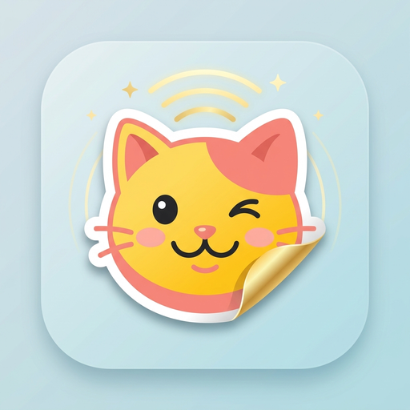

<p align="center">
  
</p>

# 表情感知 (Sticker Sense) 🌠

[](https://github.com/AstrBotDevs/AstrBot)
[](LICENSE)
[](https://github.com/YanZephyr14/astrbot_plugin_sticker_sense)

**`astrbot_plugin_sticker_sense`** 是一款专为 QQ 社交生态（OneBot V11 / aiocqhttp、QQ 官方机器人）深度定制的多模态表情与表情包感知增强插件。

在最小风险（零侵入、不改动主程序任何代码）前提下，解决大模型分不清“表情包”和“普通照片”、丢失 QQ 经典表情以及死板“看图说话”的问题，让机器人像真人一样读懂表情包与梗，幽默有温度地社交互动！

---

## 🌐 支持平台

本插件专为 **QQ 生态** 深度定制，支持 AstrBot 如下 QQ 平台适配器：
- `aiocqhttp`：OneBot V11 标准协议端（如 NapCat、Lagrange、LLOneBot 等 QQ 个人号/机器人接入）
- `qq_official`：腾讯 QQ 官方开放平台机器人
- `qq_official_webhook`：腾讯 QQ 官方 Webhook 机器人

---

## 🧐 痛点背景

1. **大模型死板看图说话**：普通多模态模型收到表情包时，往往切换到“图像特征分析”模式（例如煞有介事地描述“画面有一只猫，配文是……”），而无法像真人聊天那样把表情包理解为情绪回应、幽默互动或梗。
2. **QQ 经典表情丢失**：在 QQ/OneBot V11 等协议中，经典小黄脸表情（`Face`）在主文本中丢失，商城大表情（`mface`）被直接跳过，大模型对用户的表情符号“视而不见”。
3. **纯发表情包冷场**：用户单发表情包或纯表情时，常常因为文本为空而导致大模型调用失败或无响应。

---

## ✨ 核心特性

- 🔍 **三级智能识别引擎**：
  - **协议显式特征**：提取 OneBot V11 报文中的 `subType`/`sub_type`（1=表情包, 2=热图, 3=斗图, 7=贴纸, 9=动画表情）及 `summary`。
  - **动图探测 (Pillow)**：自动检测 GIF / 动态 WebP 等多帧动画，精准识别动图表情。
  - **启发式尺寸判别**：结合长宽阈值（默认 $\le 640$px）、宽高比与体积，智能区分小图表情包与高清生活照片/全屏截图。
- 🐶 **QQ 官方表情 100% 动态语义转义**：
  - 优先从底层报文 `raw.faceText` 动态提取表情中文名（如 `/菜汪` -> `[表情: 菜汪]`），自动覆盖全部最新 QQ 官方小黄脸与商城表情；内置 150+ 经典静态字典作为高可靠兜底。
- 🎬 **消除动图九宫格出戏幻觉**：
  - 针对底层动图抽帧合成网格，自动向大模型注入“连贯动作”认知对齐规则，彻底杜绝大模型误以为是“九宫格拼图”或数格子出戏的问题；对静态图片不注入，防止误伤真实拼图。
- 💬 **高情商社交交互与意图感知**：
  - 针对表情包提供社交互动指引（支持自然日常 `natural`、幽默接梗 `humorous`、温柔体察 `gentle`、傲娇互怼 `roast` 四种风格）；
  - 引导大模型洞察表情包背后的网络潜台词（指人打趣、认怂、赞赏、撒娇等）；
  - **人设第一底线**：硬性约束模型在任何表情交互中严守既定性格人设，杜绝 OOC；
  - 针对普通生活照片或屏幕截图，引导大模型按正常分享或求助进行理解和协助。
- 🥊 **支持双向斗图倾向提示**：
  - 可选开关 `enable_meme_reaction`，当配合表情包插件（如 `meme_manager`）时，提示大模型在适宜氛围下主动回敬表情包配合斗图。
- 🛡️ **纯表情空文本自动兜底**：
  - 用户纯发表情包或表情时自动填充语义文本，杜绝空 Prompt 异常或冷场。
- ⚡ **零破坏与缓存友好**：
  - 严格通过 `req.extra_user_content_parts` 并标注 `.mark_as_temp()` 进行临时注入；
  - **绝不篡改 `req.system_prompt`**，100% 保护大模型服务端的 Prompt 缓存，避免 Token 成本暴增；单轮生效，不污染数据库与会话历史。

---

## 🛠️ 工作流程图

```mermaid
flowchart TD
    A[用户发送消息] --> B[AstrBot 消息管道]
    B --> C[StickerSense 拦截器 @on_llm_request]
    C --> D{检测图像与表情}
    D -- 协议/动图/尺寸判定为表情包 --> E[构建表情包社交指引]
    D -- 高分辨率/大图判定为普通图片 --> F[构建普通图片分析指引]
    D -- 包含小黄脸/商城大表情 --> G[转义为语义化文本 [表情: 狗头]]
    E --> H[临时注入 req.extra_user_content_parts]
    F --> H
    G --> H
    H --> I[大语言模型推理]
    I --> J[人类化高情商自然回复]
```

---

## 📖 指令列表

| 指令 | 说明 | 权限 |
|:---|:---|:---|
| `/sticker status` | 查看表情感知插件运行状态与当前配置概览 | 所有人 |
| `/sticker toggle` | 一键快速切换表情感知功能的启用/停用 | 所有人 |

---

## ⚙️ 配置说明 (`_conf_schema.json`)

可在 AstrBot 管理面板（WebUI）中直接可视化配置：

| 配置项 | 类型 | 默认值 | 说明 |
|:---|:---|:---|:---|
| `enable_sticker_sense` | bool | `true` | 是否启用表情与表情包感知总开关 |
| `enable_face_translation` | bool | `true` | 是否将 QQ 原生经典表情转义为语义化文字 |
| `prompt_style` | string | `"natural"` | 交互风格：`natural` (自然日常) / `humorous` (幽默接梗) / `gentle` (温柔体察) / `roast` (傲娇互怼/吐槽) |
| `max_sticker_dimension` | int | `640` | 启发式判定表情包的最大边长（像素） |
| `auto_fill_empty_prompt` | bool | `true` | 纯表情包/表情空文本时是否自动补充兜底语义 |
| `enable_meme_reaction` | bool | `false` | 启用双向斗图倾向提示（配合表情包相关插件） |
| `custom_prompt_guide` | text | `""` | 可选追加的自定义表情包提示词指引 |

---

## 📄 许可证

本项目遵循 [MIT License](LICENSE) 开源协议。
